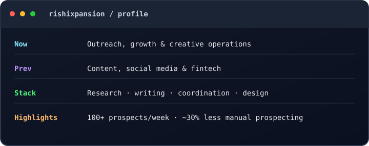

<!-- Profile README for rishixpansion -->

<h1 align="center">Hi, I'm Rishika Chaurasia</h1>
<h3 align="center">Outreach & Growth · Content & Social Media · Creative Operations</h3>

  <a href="https://itsrishidesigner.framer.website/"><strong>View my design portfolio</strong></a>
  ·
  <a href="mailto:rishixpansion@gmail.com">Contact me</a>

  

---

## About

I work at the intersection of **growth, content, client communication, and creative delivery**. My experience spans creative agencies, social media, fintech, and B2B outreach—with a focus on building repeatable workflows that help teams find opportunities, publish consistently, and deliver good work on time.

- **Growth & outreach:** prospect research, personalized cold outreach, lead generation, follow-ups, and client acquisition.
- **Content & social:** content planning, copywriting, social media management, community management, and publishing operations.
- **Creative operations:** coordinating designers, editors, clients, approvals, revisions, and deadlines.
- **Design:** graphic design and visual communication. My portfolio is the best place to explore the work.

## Selected impact

| Area | Highlights |
| --- | --- |
| Prospecting | Researched 100+ prospects per week and managed 30–40+ active prospects and follow-ups. |
| Workflow improvement | Built a repeatable outreach workflow that reduced manual prospecting time by approximately 30%. |
| Content operations | Coordinated scripting, editing, approvals, and publishing for 8–10 US-based YouTube channels. |
| Social media | Managed 5–8 client accounts and 50+ content pieces per month, with approximately 90% on-time delivery. |
| Audience growth | Increased brand reach by approximately 70% through content and marketing initiatives. |
| Community | Managed a Telegram community of 11,000+ members and contributed to an estimated 65% increase in engagement. |

*Metrics are based on my professional experience and are approximate where noted.*

## What I work with

**Growth & outreach**  
Lead research · Cold email outreach · Lead generation · Follow-ups · Client acquisition · Prospect qualification

**Content & social media**  
Content strategy · Content calendars · Copywriting · Scriptwriting · Web content · Social media management · Community management

**Creative & project operations**  
Client communication · Project coordination · Creative-team coordination · Feedback and approvals · Production workflows · Deadline management

**Creative tools & AI**  
Graphic design · Video editing · AI-assisted content creation · Prompt engineering · ChatGPT · Claude

## Featured work

### Graphic design portfolio
Explore selected design work, visual projects, and creative direction.

**[Open my portfolio →](https://itsrishidesigner.framer.website/)**

### Creative growth & content operations
My experience includes international B2B outreach, YouTube content coordination, multi-account social media management, and creative workflow development. I'm especially interested in work where strategy, communication, and execution meet.

## Experience snapshot

- **Outreach Manager — Video Editors & Designers:** prospect research, personalized outreach, pipeline management, and streamlined follow-ups.
- **Founder — RishMi Studios:** building a creative service business across positioning, client acquisition, branding, operations, and delivery.
- **Marketing & Online Presence — MySarthi.com:** digital presence, finance-focused content, and online lead generation.
- **Project / Content Coordinator — Puls Media Marketing:** coordinating content production across multiple US-based YouTube channels.
- **Social Media Manager — G4Growth:** content calendars, publishing, and creative-team coordination across client accounts.
- **Web Content & Social Media Manager — StoxCap:** social content, paid marketing initiatives, and community engagement.
- **Content & Marketing Manager — ProActieAnt:** international B2B outreach, inbound inquiries, and web/social content.

## Let's connect

- **Portfolio:** [itsrishidesigner.framer.website](https://itsrishidesigner.framer.website/)
- **Email:** [rishixpansion@gmail.com](mailto:rishixpansion@gmail.com)
- **GitHub:** [@rishixpansion](https://github.com/rishixpansion)

---

<i>Clear communication. Thoughtful creative work. Systems that make good work repeatable.</i>

